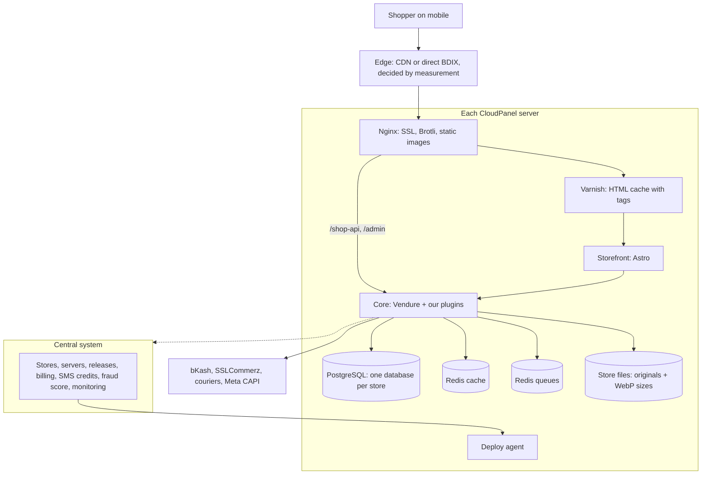

# Architecture

> Status: draft v3 · Last updated: 2026-10-20 · Companion to [mvp-spec.md](mvp-spec.md)
> Model: **one isolated site and one PostgreSQL database per store**, on our CloudPanel servers (add servers as stores grow), managed by a central system we build.

## Principles

1. **One codebase, one version for every store.** No client-specific code, ever. Customisation comes only from settings, themes and sections.
2. **Every store is fully isolated:** its own processes, database, Redis key space, cache tags, files folder and Linux user. A bug or traffic spike on one store can't touch another.
3. **Merchants own their data.** Full export (database dump, images, WooCommerce-compatible CSV) at any time. The software stays with us.
4. **The fastest option wins in every layer**, and speed budgets are enforced in CI.
5. **Fast shared services per server, small processes per store.** Each server runs one PostgreSQL, Redis and Varnish setup shared by its stores, with each store isolated inside them.
6. **Updates are our job and are automated.** One command rolls a release to every store, with backups, health checks and automatic rollback.
7. **Vendure stays on upstream releases.** We install it from npm and build our features as Vendure plugins, so an upgrade is a version bump. Small core changes go in as documented patches. See the [setup guide](../README.md), section 9.

## Where the WordPress speed tricks went

| On WordPress | Here |
|---|---|
| OPcache (keeps compiled PHP in memory) | Not needed. Node compiles the code once at start-up and keeps it in memory for the life of the process |
| Varnish (full-page cache) | **Kept.** Caches storefront HTML in memory, purged by tag when a product changes, and serves the old page while a fresh one renders |
| Redis object cache | **Kept.** Vendure's Redis cache plus the storefront's data cache. Redis also runs the job queue (BullMQ) |

## Overview



## Per-store runtime

Each store is two Node processes under PM2, plus its own space inside the server's shared services. Everything runs as the store's own CloudPanel site user.

| Piece | What it is | Idle memory |
|---|---|---|
| Core | Vendure with our plugins; the BullMQ job worker runs in the same process | 305–368 MB idle and ~190 MB after load, as measured in the benchmark (Vendure's docs say 200–300 MB). Turning off unused plugins should bring it down |
| Storefront | Astro server-side rendering on Node | ~80–120 MB (to measure) |
| PostgreSQL | Its own database and role on the server's PostgreSQL | Shared |
| Redis | Its own ACL user, limited to its key prefix, on both Redis instances | Shared, a few MB |
| Varnish | Its own backend; pages tagged with the store ID | Shared |
| Files | Original uploads plus generated WebP sizes | Disk |

- **Capacity per 32 GB server:**
  - Reserve about 4 GB for PostgreSQL, 2 GB for Varnish, 1 GB for Redis and 2 GB for the OS. That leaves ~22 GB for stores, or **about 50 stores** at ~400 MB each.
  - Year one (60–70 stores) needs two servers; year two (200) needs four or five.
  - The central system places each new store on the server with the most free memory.
  - Confirm the per-store figure in the spike.
- **Shared release folder:** every store on a server runs from the same read-only code folder, `/opt/ecommbd/releases/<version>/`. Each store differs only in its env file (database, Redis credentials and prefix, ports, files path, store ID). We build once per server, not once per store. A canary rollout points chosen stores at the new version first.

## Decision 1: Commerce core — Vendure on upstream releases, extended with plugins

### Vendure vs Medusa (both now possible with PostgreSQL + Redis)

| | Vendure | Medusa v2 |
|---|---|---|
| Language | TypeScript, NestJS + TypeORM | TypeScript, its own framework (modules, workflows, MikroORM) |
| PostgreSQL | ✅ Main database | ✅ Only database |
| Redis | ✅ BullMQ job queue and Redis cache plugins | ✅ Event bus, workflow engine, cache, locking (strongly recommended in production) |
| Shop API | GraphQL | REST |
| Idle memory | 200–300 MB per process (documented) | Not documented; measure |
| License | GPLv3 | MIT |
| Code we'd maintain forever | Conventional NestJS services, entities and resolvers | More layers of its own: dependency injection, a data-model language, module links, a workflow engine |

**Why Vendure**

- **Easiest to work with:** the code we'll read and extend for years should be conventional, and plain NestJS + TypeORM is the most conventional option here.
- **Built to be extended from outside:** plugins, config and strategies cover what we need, so we can stay on upstream releases instead of editing its source.
- **Known footprint and full Redis support:** its memory use is documented, and it has Redis plugins for both the job queue and the cache.
- **Built for PostgreSQL:** it's Vendure's main database.
- **License doesn't bite:** GPLv3 only matters if we distribute the software, and merchants get data, not code. Medusa's MIT license would matter only if we ever planned to sell the code itself.

**Benchmark result (2026-10-20, [bench/RESULTS.md](../bench/RESULTS.md)): Vendure wins clearly.** Both engines ran the same scripted guest checkout on the same PostgreSQL + Redis, each configured per its own production docs.

| | Vendure 3.8 | Medusa 2.21 |
|---|---|---|
| Checkout p95, 1 shopper | 131 ms | 313 ms |
| Checkout p95, 10 shoppers | 587 ms | 2,526 ms |
| Throughput, 10 shoppers | 21.8 checkouts/s | 4.4 checkouts/s |
| Peak memory under load | 517 MB | 1,201 MB |

Medusa needed at least 20% lower checkout p95 and lower memory to win. It was worse on both.

### Other open-source options surveyed (October 2026)

No other engine is a better base.

| Candidate | Stack | Database | License | Verdict |
|---|---|---|---|---|
| EverShop | TypeScript | PostgreSQL | GPL-3.0 | Smaller and less complete; needs 2 GB+ RAM per install; no admin roles found |
| Saleor | Python / Django | PostgreSQL | BSD-3 | Wrong language; needs Redis plus separate workers per store |
| Payload + ecommerce plugin | TypeScript / Next.js | MongoDB, Postgres, SQLite | MIT | Commerce plugin is beta: no promotions, shipping or tax; Next.js per store is heavy |
| Unchained | Node / TypeScript | MongoDB only | EUPL-1.2 | Small community, MongoDB |
| Strapi 5 | TypeScript | MySQL, Postgres | MIT | Auth, roles and admin only; all commerce logic would be ours; 2 GB+ RAM |
| Keystone 6 | TypeScript | MySQL, Postgres | MIT | Framework only, no commerce |
| Spurtcommerce | TypeScript / TypeORM | MySQL, Postgres | Unclear | API only, built for multi-vendor, small, license text looks copied |
| Openfront | TypeScript / Keystone | PostgreSQL | MIT | Very new and small |
| Ever Demand | TypeScript / NestJS | MongoDB | AGPL-3.0 | Alpha |
| Reaction / Open Commerce | Node | MongoDB | GPL-3.0 | Discontinued (2023) |
| Bagisto | PHP / Laravel | MySQL | MIT | Complete, but PHP: use as a feature reference only |

**CodeCanyon scripts aren't used:**

- **Licensing:** an Envato license covers one end product, so 200 client stores would mean 200 licenses.
- **Wrong language:** most are PHP/Laravel.
- **Risky code:** many include licence-activation code that calls home to the vendor.
- **No differentiation:** many BD agencies already deploy the same scripts.

Buying one only to study its features and screens is fine. Don't copy its code.

### How we use Vendure (staying on upstream)

`apps/core` is a standard project from `@vendure/create`, with Vendure installed from npm at an exact version. Full procedure in the [setup guide](../README.md).

1. **Reuse first:** Vendure's config and strategies (order process, payment and fulfilment handlers, shipping calculators, auth and password-hashing strategies), then our own plugins in `apps/core/src/plugins/`.
2. **Phone-only checkout stays a plugin.** A plugin mutation stores the phone and an internal placeholder email (`8801XXXXXXXXX@phone.invalid`), so Vendure's required-email rule needs no core change.
3. **Core patches only as a last step:** small, documented `patch-package` patches, each also sent upstream as a pull request so it can be dropped later.
4. **Upgrades:** take patch releases within days and minor releases within about two weeks. Bump all `@vendure/*` packages together, run `vendure doctor`, generate a migration, then build and test.
5. **Our GitHub fork of `vendurehq/vendure`** is for reading and debugging source and preparing upstream fixes. We build from it only if patches ever pile up.

### What Vendure gives us

- Customers and authentication, with pluggable strategies (we add phone OTP)
- Admin users, roles and permissions
- Products, variants and options, plus facets and collections for filters and categories
- Stock levels and allocation on order
- Cart and checkout, with an order state machine we can customise
- Payment, fulfilment, shipping and promotion interfaces
- Assets, search, the job queue, the cache service and the event bus
- The React Dashboard, which only our support team uses. Merchants use our own simple admin (`apps/admin`), which talks to the same Admin API, so roles and permissions stay Vendure's

### What we build as plugins

| Plugin | Purpose |
|---|---|
| `bd-core` | Store defaults on first start (BDT, Bangla and English, Bangladesh, tax, roles), store settings, place lists (`bdDistricts`, `bdThanas`), address fields and checks |
| `merchant-admin` | Serves our merchant admin (`apps/admin`) at `/admin` with a strict CSP |
| `bd-checkout` | Phone-only checkout, incomplete orders |
| `bd-orders` | Order states New → Confirmed → Packed → Shipped → Delivered / Returned / Cancelled, order numbers, confirmation queue, manual orders |
| `bd-print` | Print data, printed marks and print settings for invoices, packing slips, receipts and courier stickers; the print views are pages of the merchant admin, printed by the browser |
| `bd-images` | Checks and cleans every uploaded image before it is stored (type from its bytes, 15 MB, 40 megapixels, metadata and GPS removed), then makes WebP sizes on the worker, served at `/img`; one copy per content hash |
| `payments-*` | COD, manual bKash/Nagad (TrxID), SSLCommerz, bKash tokenized, partial advance |
| `shipping-bd` | Inside/outside Dhaka and per-district rates |
| `couriers-*` | Steadfast, Pathao, RedX booking and status sync |
| `meta-capi` | Pixel + Conversions API, Purchase trigger setting |
| `images` | WebP generation (Decision 3) |
| `woo-import` | WooCommerce migration |
| `sections` | Page and landing-page content for the storefront editor |
| `cache-purge` | Tags pages in Varnish and purges them on change |
| `central-client` | Talks to the central system: SMS, fraud score, health, licence |

### Spike checklist (one week, on one of your CloudPanel servers)

| Check | Pass when |
|---|---|
| ~~Engine benchmark~~ | ✅ Done locally on 2026-10-20: Vendure chosen ([bench/RESULTS.md](../bench/RESULTS.md)). Re-run `bench/` on a CloudPanel server to confirm the absolute numbers |
| Footprint | Core + storefront idle ≤ 450 MB together; core boots in < 15 s |
| Speed | Shop API p95 < 100 ms for product, add-to-cart, set address, shipping options and placing a COD order, on 2 vCPU with PostgreSQL + Redis |
| Phone checkout | Name + phone + address → order placed; no email anywhere |
| BD order flow | Custom states work end to end, including Returned |
| Partial payment | Online advance + COD remainder on one order |
| Integrations | SSLCommerz sandbox payment and Steadfast booking as plugins |
| Upgrade | Moving to the next Vendure minor version with our plugins and any patches takes < 1 hour |

Medusa lost the benchmark, so there is no fallback engine. If Vendure ever hits a wall, the boundaries in this document (storefront, central system, plugins) stay valid for a custom core.

## Decision 2: Storefront — Astro with Preact islands, behind Varnish

**Why it's the fastest:** Astro sends zero JavaScript by default. Only the interactive parts (cart, variant picker, checkout form) load as small Preact islands; Preact's runtime is about 4 KB. A Next.js or plain React storefront ships its framework runtime on every page.

- **Request path:** Nginx (SSL, Brotli) → Varnish → Astro. Home, product, category and landing pages are cached in Varnish's memory; cart, checkout and account pages bypass it.
- **Tag purge:** every cached page is tagged (with Varnish's `xkey`) with the store ID and the product, collection and section IDs on it. When a product changes, the core purges exactly the pages that show it.
- **Grace mode:** after a purge or expiry, Varnish keeps serving the previous page while it fetches a fresh one in the background. Shoppers never wait for a render.
- **Varnish setup:** CloudPanel's built-in Varnish setting is aimed at PHP sites, so the deploy agent manages one Varnish instance per server, with one backend per store.
- **Data:** the storefront calls the core's Shop API on localhost. Settings, menus and collections are cached in Redis (shared with the core) and in an in-process cache.
- **Cart and checkout:** the browser calls `/shop-api` on the store's own domain, and Nginx routes it straight to the core with no extra hop.
- **Themes:** a theme is a set of Astro components plus a settings JSON. Pages are ordered lists of **sections**, like Shopify. Each section is an Astro component with a field schema.
- **Page and landing editor, Shopify-style:** a sidebar lists the sections, with forms generated from each section's schema. Next to it is a live preview iframe of the real storefront. Because no second copy of the components exists for the editor, what the merchant sees is exactly what shoppers get. The embedded checkout is a section, so it can go on any landing page.
- **Meta Pixel and merchant scripts:** these load after the page is interactive. The server-side Conversions API carries the events, so a late-loading pixel loses nothing.
- **Fonts:** system fonts by default. Android ships Noto Sans Bengali, so Bangla text needs no font download. A brand font is optional: self-hosted, subset, `woff2`, `font-display: swap`.

**Performance budget (CI fails if exceeded):**

| Metric | Budget |
|---|---|
| First-party JS, product page | ≤ 30 KB gzipped |
| First-party JS, landing page with checkout | ≤ 45 KB gzipped |
| LCP, mobile 4G, p75 | ≤ 1.5 s |
| INP | < 200 ms |
| CLS | < 0.1 |
| HTML TTFB on Varnish hit, from BD ISPs | ≤ 150 ms |

## Decision 3: Images — sharp, WebP, generated at upload

- **One job per image:** on every upload and every migrated image, a job uses **sharp** (built on libvips, the fastest image library for Node). It rotates by EXIF, strips metadata, resizes to widths 160 / 320 / 480 / 768 / 1080 / 1600 (never upscaling) and encodes **WebP at quality ~78**. The original is kept so sizes can be regenerated later.
- **Ready before the first visit:** sizes are generated up front, so no shopper ever waits for a resize. Nginx serves them straight from disk, skipping Varnish and Node, with content-hashed names and `Cache-Control: immutable`.
- **Storefront markup:** images get `srcset` / `sizes` and explicit width and height, so nothing jumps. Images below the fold use `loading="lazy"`. The main (LCP) image uses `fetchpriority="high"` and is preloaded.
- **Later:** AVIF is about 20–30% smaller than WebP but slower to encode. Add it in P2 through `<picture>`.

## Decision 4: Database — PostgreSQL, one database per store

- **One PostgreSQL server per CloudPanel server**, installed and managed by our server scripts (CloudPanel doesn't manage PostgreSQL). Use the latest stable major version that TypeORM supports; confirm in the spike.
- **Isolation:** each store gets its own database and a role with rights only on that database, locked down in `pg_hba.conf`.
- **Migrations roll back cleanly.** PostgreSQL runs schema changes inside a transaction, so a failed migration undoes itself and the store keeps running the previous version. Migrations are still written so the previous release keeps working, which allows zero-downtime reloads.
- **Connections:** keep each store's pool small (5). That's about 250 connections for 50 stores. Add PgBouncer (transaction mode) per server if connection count becomes a problem.
- **Tuning on a 32 GB server:** `shared_buffers` ≈ 4 GB, `effective_cache_size` ≈ 12 GB, small `work_mem`. Revisit with real load.

**Backups:** your plan, done with fast tools.

| What | How |
|---|---|
| Weekly full + daily backups, 30-day retention | pgBackRest: weekly full, daily differential, parallel and compressed |
| Point-in-time recovery | pgBackRest WAL archiving: restore any store's server to the minute, not just to last night |
| Off-server copies | pgBackRest repository on S3-compatible storage at another provider |
| Single-store restore and merchant export | Nightly per-store `pg_dump` (custom format) |
| Before each release | Per-store dump right before migrating: cheap insurance against a bad data migration |
| Restore drill | Monthly: restore a random store to a test site and check it |

Back up the store files folders too. Only the originals matter, because the WebP sizes can be regenerated.

## Decision 5: Redis — two instances per server

| Instance | Used for | Settings |
|---|---|---|
| `redis-queue` | BullMQ job queues (Vendure `BullMQJobQueuePlugin`): no database polling, jobs pushed to the worker instantly | `maxmemory-policy noeviction` (BullMQ must never lose jobs), AOF persistence on |
| `redis-cache` | Vendure `RedisCachePlugin`, storefront data cache, session cache, rate limits | `allkeys-lru`, no persistence |

- **Why two instances:** the queue must never evict keys and the cache must, so one setting can't serve both.
- **Isolation:** each store gets an ACL user on each instance, limited to its own key prefix (`s<storeId>:*`). The BullMQ prefix and the cache namespace are set per store.

## Decision 6: Edge and hosting — measure from Bangladesh, then choose

The fastest route depends on how Bangladeshi ISPs reach the server, so we measure before choosing.

| Option | Pros | Cons |
|---|---|---|
| A. Origin in a BD data center on BDIX, no CDN proxy | Local ISPs reach it over BDIX, often the lowest latency in BD | Weaker DDoS protection; slower abroad |
| B. Cloudflare proxy in front | DDoS protection, WAF, global reach | Not every BD ISP uses the Dhaka location; some route via Singapore or India |
| C. Origin in Singapore, no CDN | Baseline | Every request leaves the country |

**Test:** measure TTFB and LCP for the same test store from Grameenphone, Robi and Banglalink mobile data and 2–3 broadband ISPs, for each option. The winner becomes the default for new servers. Options can also be combined, for example Cloudflare in front of a BDIX origin, if the numbers support it.

**Custom domains and SSL:** CloudPanel issues Let's Encrypt certificates per site. With Cloudflare, the central system manages domains through Cloudflare for SaaS.

**Transport:** HTTP/2 (HTTP/3 through Cloudflare), Brotli for text, long cache lifetimes for static files.

## Decision 7: Processes and background jobs

- **PM2** runs each store's processes, in cluster mode with one instance for zero-downtime reloads.
- **Background jobs:** the BullMQ worker runs inside the core process. Image and import jobs use sharp's native threads, so they don't block shopper requests.
- **Outbox:** anything that must reach an outside service (Meta, SMS, courier) is written to an `outbox` table in the **same database transaction** as the order change. A job drains it with retries, so a crash can't lose a Purchase event or an SMS.

## Server baseline (scripted, identical on every server)

CloudPanel + Nginx, then on top:

- PostgreSQL + pgBackRest
- `redis-queue` and `redis-cache`
- Varnish with `xkey`
- Node.js LTS + PM2
- The deploy agent

A new server is ready by running one script, then registering it with the central system.

## Central system

A separate app we build (TypeScript, its own database) on its own server. Stores keep selling if it's down: only SMS sending (queued), fraud scores (skipped) and updates wait.

| Area | What it does |
|---|---|
| Server and store registry | Servers and their free memory; each store's server, domain, release version, plan and status |
| Provisioning | Picks the server with the most free memory, then creates the store through CloudPanel's `clpctl` command line: site user, Nginx vhost, SSL. The agent adds the database and role, Redis ACL users, Varnish backend, env file, PM2 processes and default data. Target: a new store in under 2 minutes |
| Releases | CI builds once and signs the release. Agents install it, then it rolls out in waves (our test stores → 10% → everyone). Per store: dump → migrate → reload → health check → automatic rollback on failure |
| Billing and plans | Subscriptions and suspensions, with a grace period. Never deletes data |
| SMS | One central SMS gateway account. Stores send through the central API, with a credit ledger per store |
| Fraud network | Stores report hashed phone numbers and delivered/returned outcomes; the central system returns a score per phone |
| Monitoring | Uptime, error rates, job backlog, failed Meta/courier/SMS deliveries, RAM and disk per server |
| Support access | Time-limited, audited admin access to a store |
| Backups and exports | Schedules, off-site copies, restore drills, merchant data export |

**Deploy agent:** a small service on each CloudPanel server. It connects **out** to the central system and pulls signed instructions, so the central system never needs SSH into the servers. It runs `clpctl`, PM2, migrations and Varnish config changes, and reports back.

## Integrations

### Payments (Vendure `PaymentMethodHandler`)

- Handlers: COD, manual bKash/Nagad (TrxID, verified by staff), SSLCommerz, bKash tokenized checkout.
- Never mark an order paid from a browser redirect. Verify on the server (the SSLCommerz validation API and IPN; bKash execute/query).
- Gateway credentials are stored per store, encrypted.
- One order can hold several payments: an online advance plus a COD remainder.

### Couriers (Vendure `FulfillmentHandler`)

- Booking a parcel creates a fulfilment with its tracking code.
- Status webhooks and polling move the order along.
- One table maps each courier's statuses to ours.
- Pathao needs its own city, zone and area IDs, mapped from `packages/bd-geo`.

### SMS

- Sent through the central system's SMS API.
- Bangla and English templates for each event, editable per store.

### Meta Conversions API

1. **Browser and server get the same event.** The storefront sends each event with an `event_id` to the core, along with `fbp` and `fbc` (from the cookie or `fbclid`), client IP, user agent and URL. The deferred browser pixel fires the same `event_id`, so Meta counts it once.
2. **Saved at checkout:** `fbp`, `fbc`, IP, user agent and `external_id` are stored on the order, so a later Purchase event still matches the shopper.
3. **Prepared and sent by the outbox job:** it normalises the data (phone to `8801XXXXXXXXX`, lowercase email, names, city, country `bd`), SHA-256 hashes it, sends it to `/{pixel_id}/events` in batches with retries, and logs Meta's response.
4. **Purchase trigger, set per store:**
   - **Placed:** the browser pixel and the server event fire together, deduplicated by `event_id`.
   - **Confirmed / Delivered:** the server sends the event at that moment, and the thank-you page fires no Purchase pixel.

### WooCommerce migration (runs inside the store's core)

- **Helper WordPress plugin (primary).** The merchant installs it and pastes a one-time code. It streams data in signed chunks to the store's import endpoint, including what the REST API can't give: password hashes, Yoast/RankMath SEO fields, PixelYourSite's Pixel ID, shipping zones and settings.
- **Fallback:** WooCommerce REST API v3 with read-only keys.
- **Safe to re-run:** imports are idempotent, keyed by WooCommerce ID, and resume from a saved position. Every image goes through the WebP pipeline. Image URLs inside descriptions are rewritten.
- **Order statuses:** WooCommerce's `pending`, `processing`, `on-hold`, `completed`, `cancelled`, `refunded` and `failed` are mapped to ours.
- **Passwords:** a custom authentication strategy keeps the WordPress hash. On first login it verifies with phpass (`$P$…`) or the WordPress 6.8+ format (`$wp$2y$…`, bcrypt over a base64 HMAC-SHA384 of the password), then re-hashes with Vendure's own strategy. Port `wp_check_password` exactly and test it against real hashes.
- **URLs:** migrated stores answer on `/product/{slug}/` and `/product-category/{slug}/`; a redirects table covers the rest.
- **Final sync:** just before the DNS switch, a catch-up sync imports anything modified since the first import.

## Repository layout

npm workspaces, Vendure's own tooling default. Add Turborepo once there are several apps to build.

```
apps/
  core/          Vendure project from @vendure/create (one build, run per store)
    src/plugins/ our Vendure plugins (bd-checkout, bd-orders, payments-*, couriers-*, meta-capi, images, woo-import, sections, cache-purge, central-client)
  admin/         merchant admin: React + Vite, Bangla and English, served by the core at /admin
  storefront/    Astro SSR + Preact islands, themes and sections
  central/       central system: API + admin
  agent/         deploy agent for each CloudPanel server
  wp-migrator/   WordPress helper plugin (PHP)
packages/
  bd-geo/        divisions → districts → upazilas/thanas, courier area ID maps
  sections/      section schemas shared by storefront and editor
patches/         patch-package patches to Vendure, only if ever needed, each documented
infra/
  server/        server baseline script (PostgreSQL, pgBackRest, Redis ×2, Varnish, Node, PM2, agent)
```

## Security

- **Per-store isolation:** each store runs as its own Linux user, with its own PostgreSQL role and Redis ACL users. It can't read another store's files, data or keys.
- **No merchant code.** Merchant scripts run only in their own storefront, under a Content Security Policy.
- **Hardened GraphQL:** the harden plugin limits query complexity and turns off introspection and the playground in production.
- **Fake-order protection at checkout:** rate limits (in `redis-cache`), a honeypot or Turnstile, and a phone block list.
- **Admin protection:** two-factor auth for staff (P1) and an audit log.
- **Fast patching:** one lockfile and a dependency vulnerability scan in CI. Security fixes reach every store within 24 hours through the release pipeline, which is itself a selling point over WooCommerce.

## First steps

The full, phase-by-phase plan is in [roadmap/README.md](roadmap/README.md). These were the first steps identified here:

1. Set up the project ([setup guide](../README.md)), then run the rest of the spike checklist on one of your CloudPanel servers. The engine benchmark is done ([bench/RESULTS.md](../bench/RESULTS.md)).
2. In parallel, run the edge test from BD ISPs (options A / B / C).
3. Write the server baseline script and run it on that server.
4. Set up the monorepo, and CI with the performance budget.
5. Build the deploy agent and provisioning: one command creates a store.
6. Build one vertical slice: create a store → product with WebP images → landing page → COD checkout by phone → confirm → Steadfast booking → Purchase sent to Meta on confirm.
7. Run the WooCommerce importer against a copy of a real store, with the owner's permission.

## Sources

- Vendure: [server resource requirements](https://docs.vendure.io/guides/deployment/server-resource-requirements), [installation](https://docs.vendure.io/current/core/getting-started/installation.md), [cache guide](https://docs.vendure.io/current/core/developer-guide/cache.md), [RedisCachePlugin](https://docs.vendure.io/current/core/reference/typescript-api/cache/redis-cache-plugin.md), [BullMQJobQueuePlugin](https://docs.vendure.io/current/core/reference/core-plugins/job-queue-plugin/bull-mqjob-queue-plugin), [AssetServerPlugin](https://docs.vendure.io/current/core/reference/core-plugins/asset-server-plugin), [license change](https://vendure.io/blog/license-change-announcement)
- Medusa: [database deployment](https://www.mintlify.com/medusajs/medusa/deployment/database), [general deployment guide](https://docs.medusajs.com/learn/deployment/general/index.html.md), [cache benchmarks](https://medusajs.com/blog/medusa-cache-benchmarks/)
- Survey: [EverShop requirements](https://evershop.io/docs/development/getting-started/system-requirements), [Saleor architecture](https://docs.saleor.io/setup/architecture), [Payload database adapters](https://payloadcms.com/docs/database/overview), [Payload ecommerce plugin](https://payloadcms.com/docs/ecommerce/plugin), [Unchained](https://github.com/unchainedshop/unchained), [Strapi databases](https://docs.strapi.io/cms/configurations/database), [Keystone config](https://keystonejs.com/docs/config/config), [Spurtcommerce](https://github.com/spurtcommerce/spurtcommerce), [Openfront](https://github.com/openshiporg/openfront), [Ever Demand](https://github.com/ever-co/ever-demand), [Reaction](https://github.com/reactioncommerce/reaction), [Bagisto](https://github.com/bagisto/bagisto)
- BullMQ: [going to production](https://docs.bullmq.io/guide/going-to-production)
