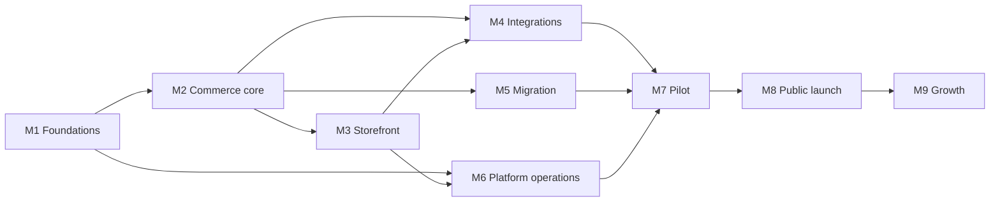

# Ecomm BD product roadmap

> Plan v1 · 2026-10-20 · 50 phases in 9 milestones
> Companion to [mvp-spec.md](../mvp-spec.md), [architecture.md](../architecture.md) and the [setup guide](../../README.md)

This is the build plan for a **product**, not a one-off project. Hundreds of merchants will run their businesses on it, and their customers will trust it with their money and personal details. So every phase ships production-quality work:

- tests for its edge cases
- a security review
- Bangla and English text
- documentation

Every phase is also a **milestone**: it ends with something you can see working.

To build a phase, ask: **"Complete phase NN."**

## Contents

- [How each phase is written](#how-each-phase-is-written)
- [Phase execution protocol](#phase-execution-protocol)
- [Milestones](#milestones)
- [Phase map and status](#phase-map-and-status)
- [Critical path to the pilot](#critical-path-to-the-pilot)
- [Who builds what (two developers)](#who-builds-what-two-developers)
- [Product standards (apply to every phase)](#product-standards-apply-to-every-phase)
- [Spec coverage](#spec-coverage)
- [Candidate features (not in the spec yet)](#candidate-features-not-in-the-spec-yet)
- [Lead-time items: start these now](#lead-time-items-start-these-now)
- [Top risks](#top-risks)
- [Decisions to make along the way](#decisions-to-make-along-the-way)

Milestone files:

1. [M1 · Foundations](m1-foundations.md) (phases 01–02)
2. [M2 · Bangladesh commerce core](m2-commerce-core.md) (03–11)
3. [M3 · Storefront](m3-storefront.md) (12–17)
4. [M4 · Payments, couriers and Meta](m4-integrations.md) (18–20)
5. [M5 · WooCommerce migration](m5-migration.md) (21–22)
6. [M6 · Platform operations](m6-platform.md) (23–29)
7. [M7 · Pilot](m7-pilot.md) (30–31)
8. [M8 · Public launch](m8-launch.md) (32–43)
9. [M9 · Growth](m9-growth.md) (44–50)

## How each phase is written

Every phase uses the same layout:

| Part | What it holds |
|---|---|
| Header table | Milestone, the spec features it delivers (with P0/P1/P2), the phases it depends on, and a relative size |
| **Goal** | One or two sentences: what's true when it's done |
| **Decide at start** | Open questions to research first; each answer is recorded in `docs/decisions.md` |
| **Build** | Concrete deliverables: plugins, entities, APIs, screens, scripts |
| **Edge cases** | Situations that must work, each needing a test or a written decision |
| **Security** | Threats specific to this phase and how they're handled |
| **Tests** | What proves it works |
| **Done when** | Acceptance checklist, demonstrated with evidence |
| **Not in this phase** | Scope boundaries, so phases don't creep |

**Words used in the phases.** *Dashboard* and *admin* mean **our merchant admin** (`apps/admin`, built in phase 02b). Vendure's own admin is always called *Vendure's Dashboard*, and only our support team uses it.

**Sizes** are relative effort: **S** small, **M** medium, **L** large, **XL** very large (consider splitting when started). They are not promises of calendar time.

## Phase execution protocol

When you ask for a phase, I work through these steps:

1. **Read.** This README, the phase, the linked spec sections, [architecture.md](../architecture.md) and the repo's `CLAUDE.md`.
2. **Check readiness.**
   - Dependencies are marked done in the status table.
   - Lead-time items the phase needs are available (sandbox credentials, accounts, servers).
   - If something is missing, I say so before writing code.
3. **Decide.** Research every "Decide at start" item, then add a line to `docs/decisions.md` with the choice and the reason.
4. **Branch.** Work on your own branch (`nafew` or `imtiaz`, see [Who builds what](#who-builds-what-two-developers)) in small, reviewable commits.
5. **Build.** Vendure plugins in `apps/core/src/plugins/`, merchant admin screens in `apps/admin`, storefront pieces and migrations, following the [product standards](#product-standards-apply-to-every-phase).
6. **Prove.**
   - Tests for each listed edge case.
   - The security checklist for the phase's surface.
   - Performance budgets pass.
   - Bangla and English strings complete.
7. **Document.**
   - Update the architecture doc if a decision changed.
   - Update the setup guide (the root `README.md`) for new environment variables or commands.
   - Draft a Bangla help article for every merchant-facing feature.
   - Add a CHANGELOG entry.
8. **Demo.** Walk through the "Done when" list with evidence: test output, screenshots, recorded API calls.
9. **Hand over.** Open a pull request with a summary and mark the phase **Review** in the status table. You review and merge, and then it becomes **Done**.

A phase is never marked done with failing tests, open high-severity security findings, or a broken performance budget.

## Milestones

| Milestone | Phases | Exit criteria | Spec phase |
|---|---|---|---|
| **M1 · Foundations** | 01–02 | CI blocks bad code. A new store starts in BDT with Bangladesh, Bangla and English, and district/thana data | 0 — Foundations |
| **M2 · Bangladesh commerce core** | 03–11 | Through the API alone: a shopper orders by phone with COD, staff confirm, print and verify payments, the customer gets SMS, and fake orders are caught | 1 — Pilot |
| **M3 · Storefront** | 12–17 | A shopper completes a COD checkout on a cached storefront within the performance budget; merchants edit pages and sales pages | 1 — Pilot |
| **M4 · Payments, couriers and Meta** | 18–20 | Sandbox SSLCommerz/bKash payments, Steadfast/Pathao booking with status sync, and deduplicated Meta events | 1 — Pilot |
| **M5 · WooCommerce migration** | 21–22 | A copy of a real WooCommerce store migrates with a clean verification report and zero broken URLs | 1 — Pilot |
| **M6 · Platform operations** | 23–29 | On a real CloudPanel server: one command creates or updates a store, backups restore, alerts fire, and load and edge tests are decided | 0 — Foundations |
| **M7 · Pilot** | 30–31 | One migrated merchant live for 30 days, meeting the MVP success criteria | 1 — Pilot |
| **M8 · Public launch** | 32–43 | All P1 features; a new merchant goes from signup to first order without help | 2 — Public launch |
| **M9 · Growth** | 44–50 | P2 features, public API, mobile admin, platform payments, scale-out | 3 — Growth |

## Phase map and status

Status values: **Not started** · **In progress** · **Review** · **Done**.

| # | Phase | Milestone | Delivers (spec priority) | Depends on | Size | Status |
|---|---|---|---|---|---|---|
| 00 | Engine benchmark and project setup | — | Vendure chosen, project runs | — | — | **Done** |
| [01](m1-foundations.md#phase-01--engineering-foundation) | Engineering foundation | M1 | Enables everything | 00 | M | **Done** (merged 2026-10-21) |
| [02](m1-foundations.md#phase-02--bangladesh-store-defaults-geo-data-store-settings-and-the-merchant-admin) | Bangladesh store defaults, geo data, store settings and the merchant admin | M1 | BD defaults, merchant admin (P0) | 01 | XL (02a, 02b) | **Done** (merged 2026-10-21) |
| [03](m2-commerce-core.md#phase-03--phone-first-customers-and-guest-checkout-api) | Phone-first customers and guest checkout API | M2 | Phone checkout, customer list (P0) | 02 | M | **Done** (merged 2026-10-21) |
| [04](m2-commerce-core.md#phase-04--bd-order-workflow-order-numbers-and-confirmation-queue) | BD order workflow, order numbers and confirmation queue | M2 | Statuses, confirmation (P0) | 03 | L | **Done** (merged 2026-10-21) |
| [05](m2-commerce-core.md#phase-05--manual-orders-order-editing-and-stock-rules) | Manual orders, order editing and stock rules | M2 | Manual orders, stock, product screens (P0) | 04 | L | Not started |
| [06](m2-commerce-core.md#phase-06--invoices-packing-slips-and-courier-stickers) | Invoices, packing slips and courier stickers | M2 | Bulk printing (P0) | 04 | M | **Review** (built 2026-10-21; Windows print check open) |
| [07](m2-commerce-core.md#phase-07--shipping-zones-and-rates) | Shipping zones and rates | M2 | Dhaka / district rates (P0) | 02, 03 | M | Not started |
| [08](m2-commerce-core.md#phase-08--payments-i-cod-manual-mobile-banking-and-partial-advance) | Payments I: COD, manual mobile banking, partial advance | M2 | COD, manual bKash/Nagad (P0), advance (P1) | 04, 07 | L | Not started |
| [09](m2-commerce-core.md#phase-09--image-pipeline-and-upload-security) | Image pipeline and upload security | M2 | WebP compression (P0) | 01 | M | Not started |
| [10](m2-commerce-core.md#phase-10--notifications-sms-templates-and-email-hygiene) | Notifications: SMS, templates and email hygiene | M2 | Order SMS (P0) | 04, 08 | M | Not started |
| [11](m2-commerce-core.md#phase-11--incomplete-orders-and-fake-order-protection) | Incomplete orders and fake-order protection | M2 | Incomplete orders (P0), OTP, block list (P1) | 03, 04, 10 | L | Not started |
| [12](m3-storefront.md#phase-12--storefront-foundation) | Storefront foundation | M3 | Bangla/English storefront, SEO, pages (P0) | 02, 09 | L | Not started |
| [13](m3-storefront.md#phase-13--catalog-browsing-search-and-filters) | Catalog browsing, search and filters | M3 | Categories, search, filters (P0) | 12 | M | Not started |
| [14](m3-storefront.md#phase-14--cart-checkout-and-order-tracking) | Cart, checkout and order tracking | M3 | Buy Now, cart, one-page checkout (P0) | 03, 07, 08, 11, 12 | L | Not started |
| [15](m3-storefront.md#phase-15--sections-themes-and-the-page-editor) | Sections, themes and the page editor | M3 | Themes, editor (P0) | 12, 13, 14 | XL | Not started |
| [16](m3-storefront.md#phase-16--sales-pages-landing-pages-funnels-and-attribution) | Sales pages: landing pages, funnels and attribution | M3 | Sales page builder (P0), order bump (P1) | 14, 15 | L | Not started |
| [17](m3-storefront.md#phase-17--speed-layer-varnish-purging-and-performance-budgets) | Speed layer: Varnish, purging and budgets | M3 | Speed success criterion | 12–16 | M | Not started |
| [18](m4-integrations.md#phase-18--online-payments-sslcommerz-and-bkash) | Online payments: SSLCommerz and bKash | M4 | SSLCommerz (P0), bKash tokenized (P1) | 08, 14 | L | Not started |
| [19](m4-integrations.md#phase-19--couriers-i-steadfast-and-pathao) | Couriers I: Steadfast and Pathao | M4 | Courier booking and sync (P0) | 04, 06, 08 | L | Not started |
| [20](m4-integrations.md#phase-20--meta-pixel-and-conversions-api) | Meta Pixel and Conversions API | M4 | Pixel + CAPI, Purchase trigger (P0), event log (P1) | 04, 14, 16 | L | Not started |
| [21](m5-migration.md#phase-21--woocommerce-importer-catalog-customers-and-orders) | WooCommerce importer: catalog, customers, orders | M5 | Woo import via API (P0) | 02, 03, 04, 09 | XL | Not started |
| [22](m5-migration.md#phase-22--wordpress-helper-plugin-passwords-seo-urls-and-cutover) | WordPress helper plugin, passwords, SEO URLs, cutover | M5 | Helper plugin, URLs, final sync (P0), passwords, SEO (P1) | 21 | XL | Not started |
| [23](m6-platform.md#phase-23--server-baseline) | Server baseline | M6 | Platform security (P0) | 01 | L | Not started |
| [24](m6-platform.md#phase-24--store-provisioning-and-lifecycle) | Store provisioning and lifecycle | M6 | Create store, subdomain, custom domain (P0) | 02, 23 | L | Not started |
| [25](m6-platform.md#phase-25--central-system-foundation) | Central system foundation | M6 | Platform registry | 24 | L | Not started |
| [26](m6-platform.md#phase-26--deploy-agent-and-release-pipeline) | Deploy agent and release pipeline | M6 | One-command updates (success criterion) | 24, 25 | L | Not started |
| [27](m6-platform.md#phase-27--backups-restore-drills-and-merchant-data-export) | Backups, restore drills and data export | M6 | Backups (P0), data export (P1) | 23, 24, 25 | L | Not started |
| [28](m6-platform.md#phase-28--observability-alerting-and-uptime) | Observability, alerting and uptime | M6 | Uptime (P0) | 23, 25 | M | Not started |
| [29](m6-platform.md#phase-29--real-server-validation-capacity-load-chaos-and-the-bd-edge-test) | Real-server validation: capacity, load, chaos, edge test | M6 | Speed and capacity decisions | 17, 23, 24, 26, 28 | M | Not started |
| [30](m7-pilot.md#phase-30--security-hardening-i-pre-pilot) | Security hardening I (pre-pilot) | M7 | Safety for real customers | 03–29 | M | Not started |
| [31](m7-pilot.md#phase-31--pilot-migrate-and-run-the-first-store-for-30-days) | Pilot: first store live for 30 days | M7 | MVP success criteria | 30 | L | Not started |
| [32](m8-launch.md#phase-32--staff-roles-two-factor-sessions-and-activity-log) | Staff roles, two-factor, sessions and activity log | M8 | Roles, activity log (P1) | 30 | L | Not started |
| [33](m8-launch.md#phase-33--simple-admin-bangla-review-mobile-and-onboarding) | Simple admin: Bangla review, mobile and onboarding | M8 | Bangla admin reviewed by merchants (P1), onboarding | 32 | M | Not started |
| [34](m8-launch.md#phase-34--customer-accounts-phone-otp-login-and-shopper-privacy) | Customer accounts: phone OTP login and privacy | M8 | Customer login (P1) | 10, 14, 22 | M | Not started |
| [35](m8-launch.md#phase-35--merchandising-extras-coupons-reviews-bulk-edit-alerts-and-custom-scripts) | Merchandising extras | M8 | Coupons, reviews, bulk edit, CSV, low stock, scripts (P1) | 10, 14, 22 | L | Not started |
| [36](m8-launch.md#phase-36--marketing-integrations-and-product-feeds) | Marketing integrations and product feeds | M8 | GA4, TikTok, GTM, Meta catalog (P1) | 20 | M | Not started |
| [37](m8-launch.md#phase-37--couriers-ii-redx-courier-fraud-check-returns-and-cod-reconciliation) | Couriers II: RedX, fraud check, returns, COD reconciliation | M8 | RedX, courier fraud check (P1) | 19 | L | Not started |
| [38](m8-launch.md#phase-38--central-sms-gateway-and-fraud-network) | Central SMS gateway and fraud network | M8 | SMS credits, cross-store score (P1) | 10, 11, 25 | L | Not started |
| [39](m8-launch.md#phase-39--plans-billing-and-limits) | Plans, billing and limits | M8 | Subscription billing (P1) | 25, 38 | L | Not started |
| [40](m8-launch.md#phase-40--self-serve-signup-custom-domains-and-onboarding) | Self-serve signup, custom domains and onboarding | M8 | Self-serve signup, migration wizard (P1) | 22, 24, 25, 26, 33, 39 | XL | Not started |
| [41](m8-launch.md#phase-41--reports-and-analytics) | Reports and analytics | M8 | Reports (P1) | 16, 19, 37 | M | Not started |
| [42](m8-launch.md#phase-42--security-hardening-ii-penetration-test-legal-and-disaster-recovery) | Security hardening II, pentest, legal, DR | M8 | Launch safety | 32–41 | L | Not started |
| [43](m8-launch.md#phase-43--launch-readiness-help-center-support-and-launch-decision) | Launch readiness: help center, support, launch decision | M8 | Public launch criterion | 42 | M | Not started |
| [44](m9-growth.md#phase-44--conversion-boosters-upsell-abandoned-checkout-sms-and-blog) | Conversion boosters: upsell, abandoned SMS, blog | M9 | Upsell, abandoned SMS, blog (P2) | 43 | M | Not started |
| [45](m9-growth.md#phase-45--more-payment-gateways-and-refunds) | More payment gateways and refunds | M9 | Nagad, aamarPay, ShurjoPay, refunds (P2) | 18 | M | Not started |
| [46](m9-growth.md#phase-46--more-couriers-and-smart-courier-assignment) | More couriers and smart courier assignment | M9 | Paperfly, eCourier and others (P2) | 37 | M | Not started |
| [47](m9-growth.md#phase-47--public-api-webhooks-and-integrations) | Public API, webhooks and integrations | M9 | Public API (Growth) | 43 | L | Not started |
| [48](m9-growth.md#phase-48--mobile-admin-app-and-push-notifications) | Mobile admin app and push notifications | M9 | Mobile admin (Growth) | 43 | L | Not started |
| [49](m9-growth.md#phase-49--platform-payments) | Platform payments | M9 | Platform-level payments (Later) | 39, 42 | XL | Not started |
| [50](m9-growth.md#phase-50--scale-and-performance-ii) | Scale and performance II | M9 | AVIF, scale-out, Banglish search | 29 | L | Not started |

## Critical path to the pilot

The pilot needs every P0 feature **and** the platform to run it. There are two tracks:

| Track | Phases | Note |
|---|---|---|
| Product | 01 → 02 → 03 → 04 → (05, 06, 07) → 08 → 09 → 10 → 11 → 12 → 13 → 14 → 15 → 16 → 17 → 18 → 19 → 20 → 21 → 22 | Mostly sequential; 05, 06 and 07 only need 04 |
| Platform | 23 → 24 → 25 → 26 → 27 → 28 → 29 | Can start any time after 01, in a separate session, because it touches different files |

Both tracks meet at **30** (security hardening), then **31** (pilot).

If only one session works at a time, the recommended order is the numeric order, with **23–24 pulled forward to just after 11**. That gives a real staging server early, so later phases are tested on CloudPanel rather than only locally.

## Who builds what (two developers)

From 2026-10-21 two developers work in parallel, each on their own branch, merging each finished phase to `main`.

| Developer | Branch | Phases, in order | Why they can run side by side |
|---|---|---|---|
| Imtiaz | `imtiaz` | 05 → 07 → 08 → 10 → 11 (orders and money) | Each needs only the one before it, or 04 |
| Nafew | `nafew` | 06, 09 → 12 → 13 (printing, images, storefront) | 06 needs only 04; 09 only 01; 12 needs 02 and 09; 13 needs 12 |

- **Where the tracks meet:** phase **14** (cart and checkout) needs both: 07, 08 and 11 from Imtiaz, 12 from Nafew. Plan it together once both are on `main`.
- **After 14:** 15 → 16 → 17 (storefront) and 18 → 19 (payments and couriers) split well again; 20 needs 16.
- **WooCommerce import (21–22)** waits until 05 and 07 are on `main`: it fills the product fields they add.
- **The platform track (23–28)** touches different files and can be picked up by whoever is free, once a CloudPanel server and the domain exist.
- **Files both tracks touch:** the admin's `messages/en.ts` and `bn.ts`, `menu.ts` and `main.tsx`; `apps/core/src/plugins/index.ts`; `packages/shared/src/index.ts`; the store-defaults step list in `store-defaults.e2e-spec.ts`; `docs/decisions.md`, `CHANGELOG.md` and the status table. Add new entries at the end of each list. Each developer generates their own migrations and never edits the other's; after merging `main`, run `npm run migrate:run`, then `npm run migrate:generate -- check` should report no changes.

## Product standards (apply to every phase)

These rules hold in every phase without being repeated. A phase's own sections only add to them.

> **For the MVP, these are goals, applied simply.** Tooling stays light: one CI job, plain tests, no strict audit gates ([decisions](../decisions.md), 2026-10-20). Stricter checks (automated permission audits, dependency-audit gates, security scanners) get added only when needed.

### Definition of done

- Every "Done when" item is demonstrated, with evidence in the PR.
- Every listed edge case has a test, or a note in `docs/decisions.md` explaining why not.
- CI is green: lint, typecheck, unit tests, end-to-end tests, build and browser tests.
- Database migrations are generated, reviewed and backward-compatible (see [Releases](#versioning-and-releases)).
- All shopper- and merchant-facing text exists in Bangla and English.
- New background work has logs, metrics and a visible failure state for staff (nothing fails silently).
- Docs are updated: architecture if a decision changed, setup guide for new environment variables, a Bangla help draft for merchant features, and the CHANGELOG.
- Performance budgets still pass.
- No secrets in the repo; new configuration is validated at startup with a clear error.

### Money, time, phone numbers and text

| Topic | Rule |
|---|---|
| Money | Stored as integers in minor units (Vendure's default). Prices, shipping and discounts are **whole taka**, so order totals and COD amounts are whole taka (couriers require it). Percentage discounts and fees round half-up to the nearest taka at line level. Display: `৳1,250`, using Bangladeshi lakh grouping for large amounts (`৳1,00,000`), with optional Bangla digits (`৳১,২৫০`) |
| Time | Stored in UTC. Shown and calculated in **Asia/Dhaka** (UTC+6, no daylight saving): "today", reports, quiet hours, cut-offs, promotion start and end. Bangladesh's weekend (Friday, often Saturday) matters for courier pickups |
| Phone numbers | One normalizer in `packages/shared`. Stored as E.164 (`+8801XXXXXXXXX`), shown as `01XXX-XXXXXX`. Accepts Bangla digits, `+880`, `880`, `00880`, spaces, dashes and brackets. Mobile prefixes are `013`–`019`. Landlines are rejected wherever an SMS-capable number is needed |
| Text | Trim, collapse spaces and normalize to Unicode NFC. Note that NFC turns `ড়` (U+09DC) into `ড` + `়`, so always compare normalized forms. **Never strip ZWJ/ZWNJ** (U+200D/U+200C): Bangla conjuncts need them. Strip only zero-width spaces and BOMs. Accept Bangla digits in number and phone inputs and convert them for storage |
| Names | Store one full-name field per order. Don't assume first/last structure, and allow Bangla script |
| IDs | Anything a shopper can look up needs two factors (order number + phone, or an unguessable token). Never expose guessable IDs alone |

### Reliability

- **Outbox:** every effect outside the database (SMS, Meta, couriers, gateways, purges, central calls) is written to an outbox row in the same transaction, then sent by a job.
- **Jobs:** idempotent, retried with exponential backoff and jitter, capped attempts, and a "Failed tasks" view in the Dashboard with manual retry.
- **Idempotency keys:** on every create-type mutation a client might retry (place order, book courier, start payment). Webhooks are de-duplicated by the provider's event or transaction ID.
- **Outbound HTTP:** one client wrapper in `packages/shared`, with connect and total timeouts, retries only for idempotent calls, a circuit breaker per provider, and logging with redaction.
- **Graceful degradation:** if Redis cache, Meta, SMS, a courier or central is down, shoppers can still order; the work queues and catches up.
- **Configuration:** environment variables validated at boot (zod). Per-store settings live in Vendure's settings store. Secrets are encrypted with AES-256-GCM under a per-store key, with key versions so keys can be rotated.

### Security baseline

OWASP ASVS Level 2 is the reference. Every phase applies:

| Area | Rule |
|---|---|
| Authorization | Every custom resolver and route declares permissions (`@Allow(...)` with our own permission definitions). Shop API resolvers check that the active order or customer belongs to the session. Checked in review: Vendure ignores `@Allow` on a class, so it goes on each method |
| Input | Validated at the boundary with typed schemas and length limits. Rich text is sanitized server-side on save and again on render. No `set:html` or `innerHTML` with unsanitized content |
| Rate limits | Redis-backed limits on login, OTP, checkout, coupons, tracking lookups and event endpoints. Limit by phone and session before IP: Bangladeshi mobile users share IPs behind carrier-grade NAT |
| Secrets | Never logged, encrypted at rest, least privilege, rotation documented |
| Webhooks | Signature or secret checked, timestamp tolerance, replay protection, idempotent handling |
| Uploads | Type sniffed from file bytes, size and pixel limits, re-encoded, never served from the upload path |
| Outbound URLs | Any URL that comes from data (imports, feeds, webhooks) goes through the SSRF guard: no private or link-local IP ranges, DNS checked at connect time, size and time limits, limited redirects |
| Exports | Cells starting with `=`, `+`, `-`, `@` or a tab are prefixed (CSV injection). Files are UTF-8 with BOM so Excel shows Bangla correctly |
| Logs | No full phone numbers, emails, addresses, tokens or OTPs (phones show the last 3 digits). Every request has an ID |
| Web | CSP, HSTS, `nosniff`, a strict Referrer-Policy and Permissions-Policy. Cookies are `Secure`, `HttpOnly` and `SameSite=Lax` |
| Supply chain | Lockfile, `npm ci`, CI audit. Each new dependency is reviewed for licence, maintenance and install scripts. Vendure upgrades follow the [setup guide](../../README.md), section 9 |

### Privacy

- Collect only what the feature needs. Shopper data belongs to the merchant; we process it on their behalf.
- **Default retention:** incomplete checkouts 30 days; raw IP addresses 90 days; application logs 30 days; audit logs 1 year; backups 30 days.
- Shoppers can request export or deletion through the merchant. Deletion anonymizes personal fields on orders and keeps the financial records.
- No shopper data goes to third parties except as the merchant configures (couriers, SMS, Meta with hashed fields, gateways).

### Testing

| Layer | Tool | Scope |
|---|---|---|
| Unit | Vitest | Pure logic: normalizers, calculators, mappers, state rules |
| API end-to-end | `@vendure/testing` against real PostgreSQL and Redis | Every mutation and query we add, including permission denials |
| Storefront end-to-end | Playwright on mobile emulation with a slow-4G profile, in Bangla and English | Every shopper flow touched |
| Contract | Recorded fixtures plus a mock server per external API; nightly runs against sandboxes where available | Gateways, couriers, SMS, Meta, WooCommerce |
| Load | k6 | Phases 17, 21, 29 and any hot path |
| Security | ZAP baseline, Semgrep, dependency audit, secret scan | CI plus pre-pilot and pre-launch |

### Performance

- Storefront budgets from [architecture.md](../architecture.md), Decision 2, are enforced in CI from phase 17: ≤ 30 KB first-party JS on product pages, ≤ 45 KB on landing pages with checkout, LCP ≤ 1.5 s at p75.
- Shop API targets: p95 < 100 ms for cart and checkout calls on a 2 vCPU server.
- No third-party script in the critical rendering path, ever.

### Bangla and English

- Every string has both languages from day one; Bangla is the default for the merchant-facing help.
- Use a shared glossary in `docs/glossary.md`, created in phase 01, so terms stay consistent (অর্ডার, ডেলিভারি, ক্যাশ অন ডেলিভারি…).
- Layouts are tested with long Bangla strings and Bangla digits.

### Environments

| Environment | Where | From phase |
|---|---|---|
| Local | `docker-compose.yml` (PostgreSQL, two Redis, later Varnish) | Now |
| CI | GitHub Actions with service containers | 01 |
| Staging | A real CloudPanel server, stores on `*.staging.ecomm.bd` | 23–24 |
| Production | CloudPanel servers, stores on `*.ecomm.bd` and custom domains | 24, used from 31 |

### Versioning and releases

- One version number for the whole product. Core, admin and storefront always ship together to a store.
- `CHANGELOG.md` uses the Keep a Changelog format; merchant-facing notes appear in the Dashboard's "What's new".
- **Expand and contract migrations:** a release may add tables and columns. Removing or renaming happens only in a later release, once no running version uses them. Review checks this, so any store can roll back one release without restoring its database.
- Feature flags (per store) gate risky or plan-specific features. They default on for internal test stores first.

## Spec coverage

Every feature in [mvp-spec.md](../mvp-spec.md) section 4 maps to a phase.

| Spec feature | Priority | Phase(s) |
|---|---|---|
| Sign up, create store, free subdomain | P0 | 24 (we provision for the pilot), 40 (self-serve) |
| Custom domain with automatic SSL | P0 | 24, 40 |
| Storefront in Bangla and English | P0 | 12 |
| Bangladesh defaults for every new store | P0 | 02 |
| Merchant admin of our own, Bangla and English | P0 | 02b (app and menu); 03, 04, 05, 06, 11, 19 (screens) |
| Admin reviewed by Bangla-only merchants, onboarding | P1 | 33 |
| Staff accounts with roles | P1 | 32 (roles defined early in 02) |
| Subscription billing | P1 | 39 |
| Merchant data export | P1 | 27 |
| Backups, uptime, security patches | P0 | 23, 26, 27, 28, 30 |
| Simple and variable products | P0 | Vendure core; product screens in 05; weight in 07; SEO fields in 12 |
| WebP image compression | P0 | 09 |
| Categories and tags | P0 | 13 |
| Search and filters | P0 | 13 |
| SEO title/description, clean URLs, sitemap | P0 | 12 |
| Bulk edit, CSV import/export | P1 | 35 |
| Product reviews | P1 | 35 (imported in 22) |
| Themes with settings | P0 | 15 |
| Sales page builder (landing pages) with embedded checkout | P0 | 16 |
| Buy Now and slide-out cart | P0 | 14 |
| WhatsApp / Messenger / call button | P0 | 12 |
| Static pages and menus | P0 | 12 |
| Custom head/footer scripts | P1 | 35 |
| Blog | P2 | 44 |
| One-page checkout | P0 | 03 (API), 14 (UI) |
| BD phone validation | P0 | 01 (library), 03, 14 |
| Shipping rates | P0 | 07 |
| Incomplete orders | P0 | 11 |
| Coupons | P1 | 35 |
| Order bump | P1 | 16 (built with the embedded checkout) |
| OTP for COD orders | P1 | 11 |
| One-click upsell | P2 | 44 |
| Cash on delivery | P0 | 08 |
| SSLCommerz | P0 | 18 |
| Manual bKash / Nagad | P0 | 08 |
| Partial advance | P1 | 08 (manual), 18 (online) |
| bKash tokenized checkout | P1 | 18 |
| Nagad direct, aamarPay, ShurjoPay | P2 | 45 |
| Refunds through gateway APIs | P2 | 45 |
| Platform-level payments | Later | 49 |
| Order list with BD statuses | P0 | 04 |
| Confirmation workflow | P0 | 04 |
| Manual order entry | P0 | 05 |
| Bulk invoice and sticker printing | P0 | 06 |
| Steadfast and Pathao | P0 | 19 |
| RedX | P1 | 37 |
| Paperfly, eCourier and others | P2 | 46 |
| COD fraud check | P1 | 11 (own store), 37 (couriers), 38 (cross-store) |
| Block list | P1 | 11 |
| Stock deduction | P0 | 05 |
| Low-stock alerts | P1 | 35 |
| Customer list keyed by phone | P0 | 03 |
| Order SMS in Bangla | P0 | 10 (credits: 38, 39) |
| Customer login | P1 | 34 (passwords from 22) |
| Meta Pixel + Conversions API | P0 | 20 |
| Purchase trigger setting | P0 | 20 |
| Meta event log | P1 | 20 (pulled forward: needed to debug the pilot) |
| Meta catalog feed | P1 | 36 |
| GA4, TikTok, GTM | P1 | 36 |
| Abandoned checkout SMS | P2 | 44 |
| Helper plugin or API-key connection | P0 | 21 (API keys), 22 (plugin) |
| Import products, customers, orders | P0 | 21 |
| Import coupons, reviews, SEO, Pixel ID | P1 | 22 (pulled forward: the plugin exports them anyway) |
| Keep WooCommerce URLs, 301s | P0 | 12 (URL scheme), 22 (redirects) |
| Customers keep passwords | P1 | 22 (verification), 34 (login screens) |
| Dry run → import → final sync | P0 | 21, 22 |
| Self-serve migration wizard | P1 | 40 |
| Dashboard home widgets | P0 | 04, 19 |
| Reports | P1 | 41 |
| Activity log | P1 | 32 |

**Success criteria:** speed (17, 29), migration time (21), Meta match quality (20), one-command updates (26), merchant never touches a server (24–28), pilot (31).

**Not in the spec but added, because a product needs them:**

- COD reconciliation (37)
- returns workflow (37)
- order numbers without gaps (04)
- shopper privacy and deletion (34)
- Digital Commerce Guidelines review (42)
- disaster recovery exercise (42)

## Candidate features (not in the spec yet)

These features came from the admin menu of the reference WooCommerce store (October 2026), where the merchant runs a plugin for each. They're **candidates**: before any of them joins the spec, check how many of the 20–30 surveyed stores use it (spec section 8, "Validating the feature list"), then give it a priority and a phase.

| Feature | What it does in the reference store | How we'd build it | Best-fit phase | Question to validate |
|---|---|---|---|---|
| **Brands** | Brand pages and a brand filter; brand shown on each product. Brands are now part of WooCommerce itself, so many imported stores will have brand data | A "brand" facet with logo and description per brand, brand pages, the brand filter, brand in JSON-LD and the products list, imported from WooCommerce's brand taxonomy | 13 (storefront), 21–22 (import), 33 (admin menu) | How many surveyed stores use brands, and do they need brand pages or only the filter? |
| **Linked Variations** | Links separate products (for example the same dress in different colours) and shows swatches on the product page to jump between them | A "product group" link between products with a swatch attribute (colour or size); swatches on the product page linking to each sibling's URL; imported from the plugin's data through the helper plugin, if readable | 15 (product page section), 22 (import) | Keep them as separate products (each with its own URL and SEO) or merge into one product with variants on import? |
| **Frequently Bought Together** | A bundle suggestion on the product page ("Buy these together for ৳X"), adding all items to the cart in one tap, sometimes with a bundle discount | A related-products list per product, a bundle discount through a promotion, and a product page section with a small "add all" island | 35 or 44 | Do merchants pick the pairs by hand, or expect automatic suggestions from order history? |
| **Custom Tabs** | Extra tabs on the product page: delivery information, care instructions, FAQs, set globally or per product | Product page sections with global defaults (store settings) and per-product or per-category overrides. On phones, accordions work better than tabs | 15 | Which tabs do stores actually use, and is store-wide content enough for most? |
| **Size Guides** | A size chart (table or image) per category or product, opened from a "Size guide" link next to the size selector | A size guide record (table rows and columns, or an image, in Bangla and English) assigned to categories or products, opened in a native `<dialog>` with no extra JavaScript | 15 or 35 | Tables or images? Inches, centimetres or both? |
| **Wishlists** | Shoppers save products to look at later | Guest wishlists saved in the browser, synced to the account after login (phase 34). Later, "back in stock" or "price dropped" SMS | 34 (+ 44 for alerts) | Do shoppers on COD, ad-driven stores use wishlists much? Check the reference store's wishlist data during migration |

## Lead-time items: start these now

These depend on other companies or the law and can take weeks. None of them needs code.

| Item | Needed by phase | Why it takes time |
|---|---|---|
| Register `ecomm.bd` (confirm .bd registry rules allow it) and choose a DNS host with an API | 23, 24 | Wildcard certificates for `*.ecomm.bd` need DNS-01 challenges, and BTCL's DNS has no API |
| A CloudPanel server for staging | 23 | Purchase and setup |
| A small VPS inside Bangladesh for latency and uptime probes | 28, 29 | Probes must run from Bangladeshi networks |
| SSLCommerz sandbox, then live merchant account | 18 | Application review |
| bKash PGW (tokenized checkout) sandbox and merchant credentials | 18 | Application review |
| Steadfast, Pathao (merchant API), RedX API access | 19, 37 | API credentials per merchant account |
| SMS provider account and a sender ID (masking) approval | 10 | Sender IDs need approval |
| Meta Business account, a test Pixel and a Conversions API token | 20 | Business verification |
| Off-site backup storage (S3-compatible, at a different provider, with object lock) | 27 | Account, billing |
| Pilot merchant agreement and a copy of their store data | 21, 31 | Consent and trust |
| Lawyer: privacy policy, terms, data protection, Digital Commerce Operation Guidelines 2021 | 42 | Legal review |
| Accountant: VAT on subscriptions, invoicing rules | 39 | Tax advice |

## Top risks

| Risk | Impact | Mitigation | Phase |
|---|---|---|---|
| Per-store memory is higher than planned (Vendure idle was 305–368 MB) | Fewer stores per server, higher cost | Run the worker in-process, turn off unused plugins, measure density on real hardware | 29 |
| Courier APIs are poorly documented or change without notice | Broken booking or status sync | Contract tests, nightly sandbox runs, polling fallback, manual booking fallback | 19, 37 |
| Gateway or courier approvals are slow | Pilot delayed | Start lead-time items now; COD and manual bKash work without any approval | 08 |
| WooCommerce data is far messier than expected | Migration failures, merchant distrust | Test on many real stores, dry-run reports, white-glove pilot migrations | 21, 22, 31 |
| `.bd` domain rules or DNS limits block wildcard subdomains | No free subdomains | Confirm early; fall back to a `.com` platform domain for subdomains if needed | Lead time |
| A security incident on a merchant store | Reputation loss | Hardening phases, per-store isolation, pentest, fast patch pipeline | 23, 30, 42 |
| Bangladesh law or payment rules change | Feature rework | Lawyer review, feature flags, compliance phase | 42, 49 |
| Review bandwidth: I write, your team reviews | Bugs slip through | Small PRs, strong tests, demos per phase, CI as the gate | All |

## Decisions to make along the way

Each answer is recorded in `docs/decisions.md` at the start of its phase.

| Decision | Phase |
|---|---|
| ~~Lint and format tooling; GitHub Actions layout; Dependabot or Renovate~~ (decided: ESLint + Prettier, one CI job, Dependabot) | 01 |
| Source and licence of the district/upazila/thana dataset; whether to use Vendure provinces for districts; rounding policy details | 02 |
| How names map to Vendure's first/last name fields; guest checkout for registered phones | 03 |
| Order number format; whether "New" maps to Vendure's PaymentAuthorized | 04 |
| How historical WooCommerce orders are stored (real Vendure orders vs a read-only legacy table) | 21 |
| SMS provider | 10 |
| Search engine for Bangla (Vendure's default vs a custom pg_trgm strategy) | 13 |
| Live stock and price checks on cached product pages, or purges only | 17 |
| Ansible vs plain scripts; OS version | 23 |
| Central system stack | 25 |
| Artifact signing tool and storage | 26 |
| Log, metrics and error-tracking stack | 28 |
| Worker in-process vs separate; CDN or BDIX; PgBouncer | 29 |
